<p align="center">
  
</p>

<h1 align="center">Budget</h1>

<p align="center">
  <b>A calm budgeting app for iPhone that runs on a computer you own.</b><br>
  Your ledger lives on your machine, and the AI is optional and yours to choose. Free and open source, with no ads and no account with us.
</p>

<p align="center">
  <a href="LICENSE"></a>
  
  
  
</p>

<p align="center">
  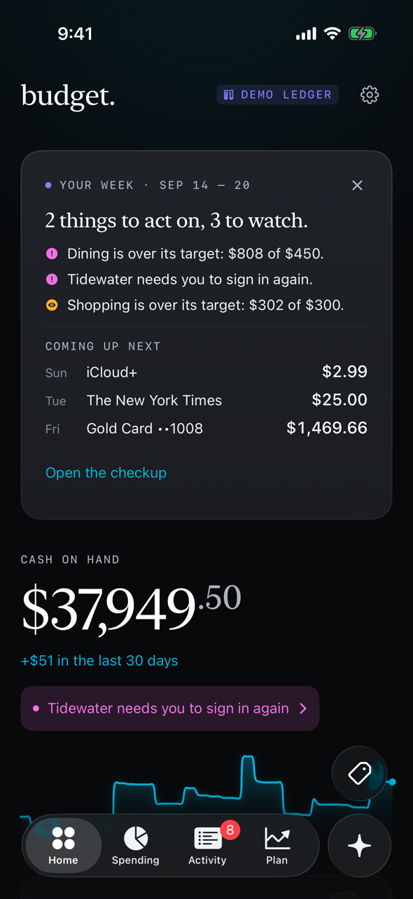
  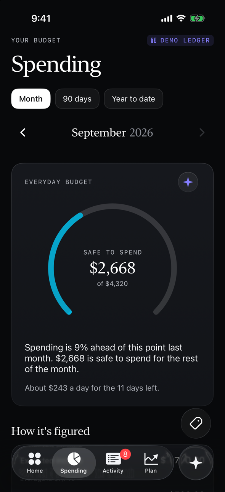
  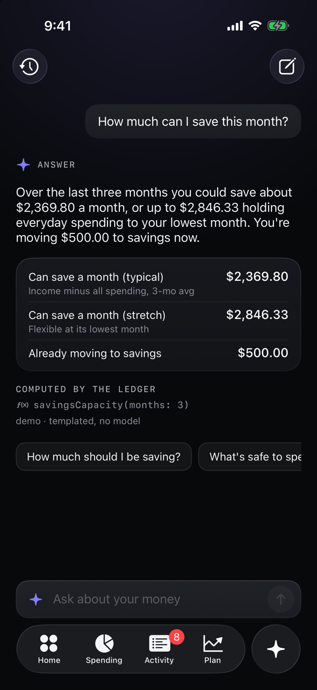
  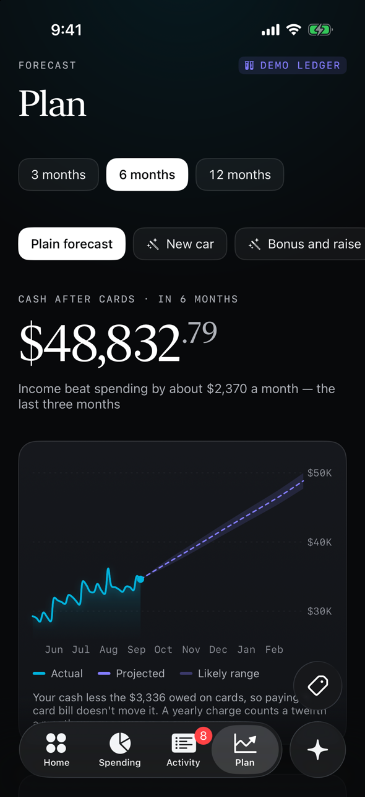
  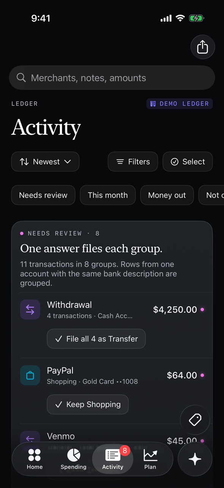
</p>

<p align="center"><sub>Screenshots use the built-in demo ledger: a made-up household, made-up banks.</sub></p>

---

Most budgeting apps keep your whole financial history on their servers, charge every month, and leave you spending Sunday afternoons sorting transactions into envelopes. Budget does the opposite. It runs on a Mac mini or a home server you already have, keeps everything there, and does the sorting for you, so the app can answer the only questions you actually open it for:

- **How much is safe to spend this month?**
- **How much can I save?**
- **What's my DoorDash budget, really?**

## What it does

**One number, honestly worked out.** Budget pays your savings first, sets aside your bills and subscriptions, and what's left is your everyday budget. *Safe to spend* is that budget minus what you've spent so far, and Home leads with it. Expected income is the lower of your last paychecks and your three-month average, so one bonus month doesn't fool it. The method, and why it beat YNAB-style envelopes and 50/30/20, is in [docs/BUDGETING.md](docs/BUDGETING.md).

**It files things, and asks when it isn't sure.** Rules you write, merchants it remembers and an optional AI model sort new transactions. Anything uncertain waits in Review, grouped so one answer files a whole batch ("Also file the 3 others like it").

**Ask it anything about your money.** Ask answers from your real ledger using tools that do the math in code, never in the model, and it shows which tool it used. When it suggests a change, such as a new budget target or a rule, you see it and apply it yourself.

**It sees what's coming.** Plan forecasts your cash after card balances for the next 3, 6 or 12 months, and lets you try "what if" scenarios: a new car, a bonus and a raise. Recurring finds your bills and subscriptions, asks when a new one starts, and notices when one stops ("Did this stop? Yes, I canceled it" gives the money back to this month's budget right away).

**And a few things that are just nice.**
- **Opportunity cost:** type a price and see how many hours of work it costs you, before and after tax, and what it would have grown to in ten years.
- **A checkup** whenever you want one: what to act on, what to watch, what's fine.
- **A morning summary** notification with your pace for the month.
- **Card rewards and statement credits** count as money in, never as spending.
- **Import statements** as CSV, OFX or QFX, with undo, for banks you'd rather not link.

<p align="center">
  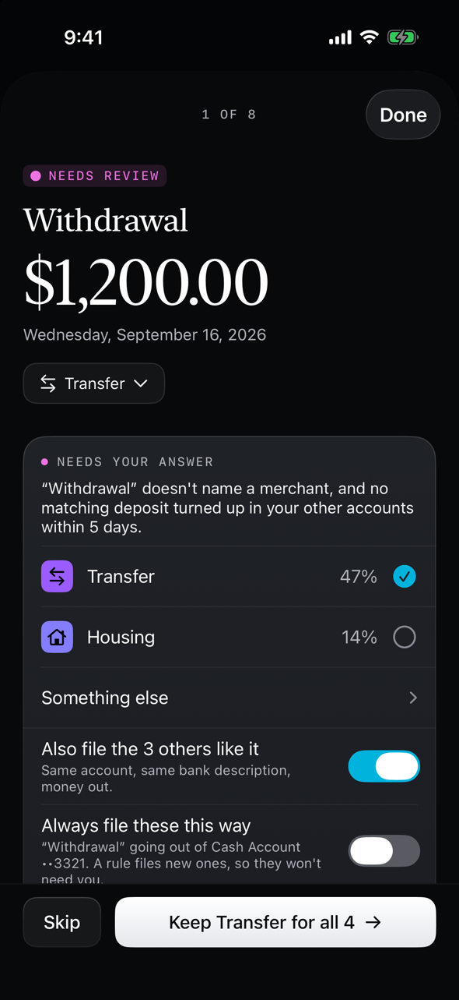
  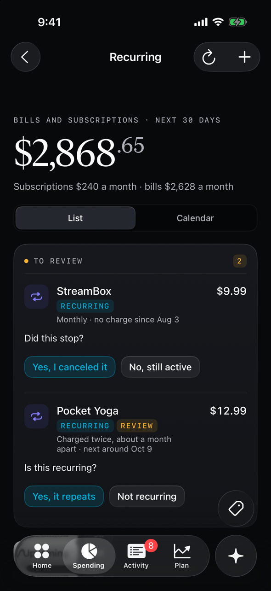
  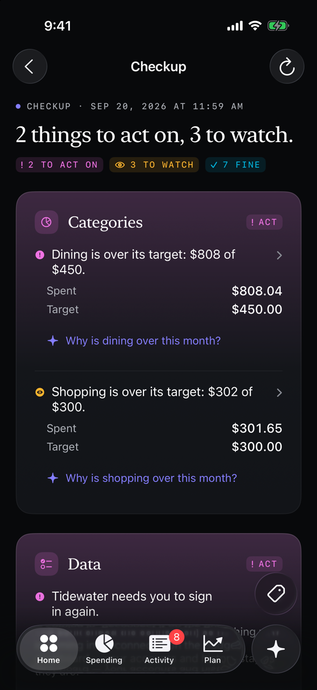
  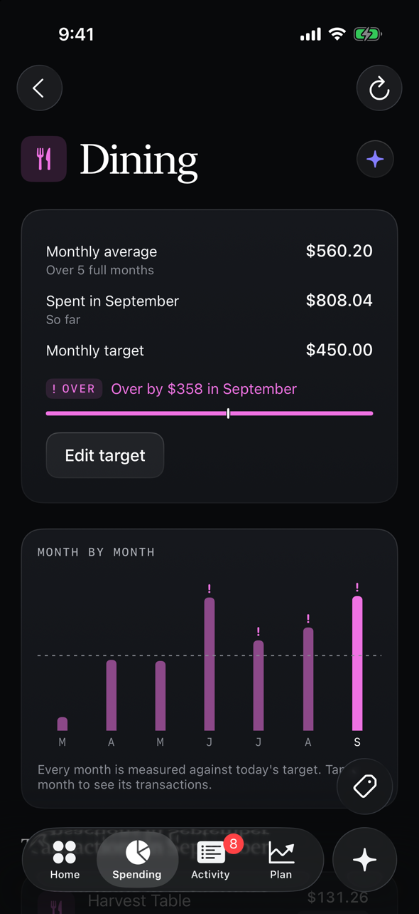
</p>

## The dashboard

Linking banks, importing statements, reviewing in bulk, and editing categories and rules happen on a web dashboard served by the same server. It only listens on the server itself, so nobody else on your network can open it.

<p align="center">
  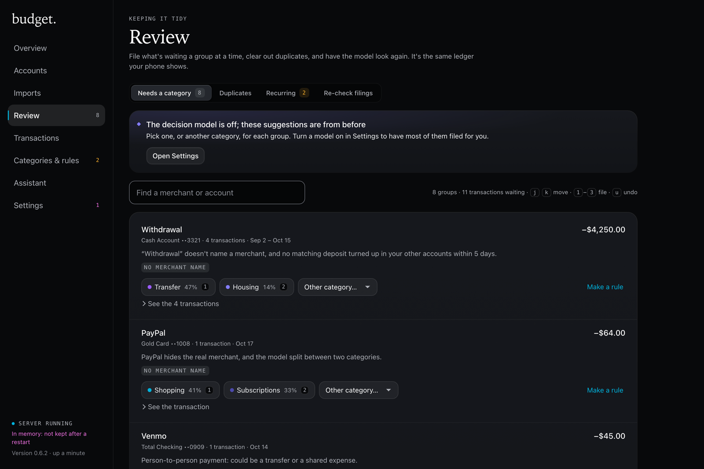
  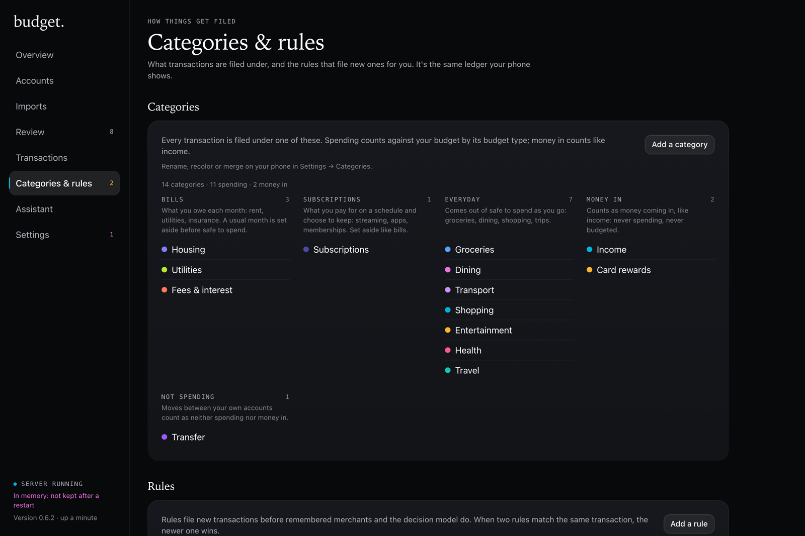
</p>

## How it works

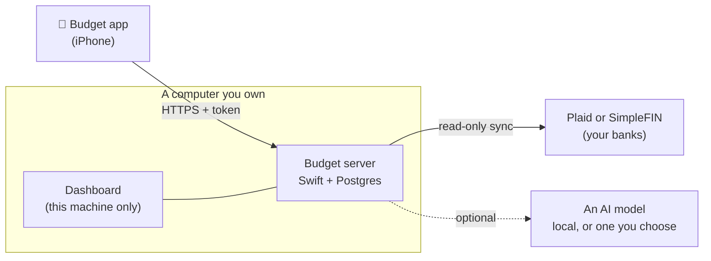

- **The server** keeps the ledger in Postgres, syncs your banks on a schedule, backs itself up daily, and seals bank tokens with a key only it has.
- **The phone** is a thin client. It reaches the server over HTTPS through Tailscale, Caddy on your own domain, or a Cloudflare Tunnel; `setup.sh` sets up whichever you pick.
- **Banks** connect through [SimpleFIN Bridge](https://beta-bridge.simplefin.org) ($1.50 a month or $15 a year, easy to sign up for) or [Plaid](https://plaid.com) (free on its Trial plan, with more sign-up steps). Both are read-only.
- **AI is optional.** Point it at any OpenAI-compatible model: one running on your own hardware, or a hosted one through OpenRouter with zero data retention. With no model at all, Ask still answers from built-in templates and uncertain transactions simply wait for you.

## Try it in two minutes

You don't need a server or a bank to look around. On a Mac with Xcode and [XcodeGen](https://github.com/yonaskolb/XcodeGen):

```sh
git clone <this repo> budget && cd budget
xcodegen generate && open Budget.xcodeproj
```

Run it on a simulator. The app opens on the demo ledger, six months of a made-up household, and every screen works.

## Set up your own

You'll need:

- **A computer that stays on** for the server: a Mac (a Mac mini is ideal), or anything that runs Docker, such as a Linux box or a NAS.
- **A Mac with Xcode** to build the app. It can be the same Mac.
- **An iPhone on iOS 26** and an Apple ID. A free Apple account works, with limits: no notifications, and you reinstall every 7 days. A paid developer account removes them.
- **SimpleFIN or Plaid** for your banks, or statement files if you'd rather not link at all.

Then:

```sh
./setup.sh before   # anything that needs your password or a browser, as steps to paste or click
./setup.sh          # the server, the phone's HTTPS address, the app, pairing, your banks
```

`setup.sh` asks before each step, skips what's already done, and never shows your secrets. Run it again any time to update: `git pull && ./setup.sh`. The full walkthrough is [docs/SETUP.md](docs/SETUP.md).

**Using a coding agent?** Point it at this repo. [CLAUDE.md](CLAUDE.md) and `./setup.sh check --json` tell it where your machine stands and what's next, and it will stop and hand you the steps only you can do, like signing in to your bank or Apple.

## Privacy and safety

- **Your data lives in your Postgres**, on your machine. Budget has no analytics, no tracking and no account with us.
- **Bank sign-in tokens are encrypted** at rest with a key you keep (`BUDGET_TOKEN_KEY`), and the server backs up daily.
- **The phone needs a bearer token** to reach the API. `./setup.sh app` pairs it without the token ever appearing on screen.
- **The dashboard isn't exposed.** It answers on the server only; reach it from another computer through an SSH tunnel.
- **The AI never does the math.** Numbers come from ledger tools; the model only chooses which to call and phrases the answer. It proposes changes; you apply them.

## Documentation

| | |
|---|---|
| [Setup](docs/SETUP.md) | From a fresh clone to your phone with banks linked |
| [Server install](docs/INSTALL-SERVER.md) · [App install](docs/INSTALL-APP.md) | The detailed steps behind `setup.sh` |
| [Running the server](docs/SERVER.md) | Settings, backups, upgrades, the dashboard |
| [Budgeting method](docs/BUDGETING.md) | How safe to spend, buckets and expected income are worked out |
| [Assistant](docs/ASSISTANT.md) | Ask's tools, prompt, grounding and the decision model |
| [Design](docs/DESIGN.md) | The visual language and components |
| [API](docs/API.md) | The server contract |
| [Development](docs/DEVELOPMENT.md) | Repo layout, building, tests, launch arguments |

## Status

Budget is a personal project, built for and used daily by one household, and it works end to end: the app, the server, the dashboard, bank sync, the assistant and the morning summary. It has been used with US banks. Expect a few rough edges, and open an issue if you hit one. Pull requests are welcome; see [Development](docs/DEVELOPMENT.md).

## License

[Apache License 2.0](LICENSE).
